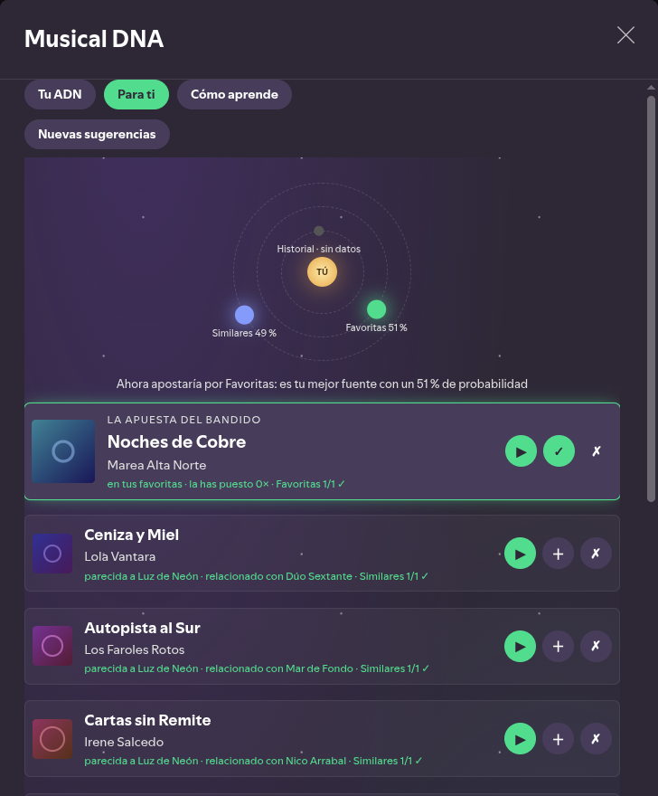

# Musical DNA

🇬🇧 English · 🇪🇸 [Español](README-ES.md)

A [Spicetify](https://spicetify.app) extension that shows you **what defines your taste** and suggests songs with a small recommender that **learns from what you listen to**. Everything stays on your machine.

> **Status: v0.1 in development.** It needs [Listening Intelligence](https://github.com/D4vRAM369/listening-intelligence_spicetify): it uses its history. The interface is in Spanish.

## What it does

An icon (a double helix) in Spotify's top bar opens a panel with three tabs:

| Tab | What you see |
|---|---|
| **Para ti** (For you) | Your **solar system**, with the suggestions below. On top, "the bandit's bet". Each suggestion says **why** it is there and how well its source performs. ▶ plays it, ＋ saves it to "Liked Songs" (turns into ✓), ✗ dismisses it forever (↺ undoes). More batches load as you scroll down. |
| **Cómo aprende** (How it learns) | Hits for each source, the probability the bandit assigns to each being the best, and your latest trials (✓ / ✗ / ⏳). |
| **Tu ADN** (Your DNA) | Your seed songs over three horizons (7 days, 30 days, all time), with their signals and a notice when there is little data. Plus your "anti-taste": what you always skip. |

<p align="center">
  
</p>

### Your solar system

You are the sun and each source is a planet orbiting you. **The bigger and brighter, the more likely it is your best source** based on what it has learned. A source with no candidates is shown in grey.

**Click a planet** to see only that source's suggestions, its card (hits, probability, pending trials) and a button to play one of its songs. Click the sun (TÚ) or the same planet again to see everything.

<p align="center">
  
  &nbsp;
  
</p>

When you reach the end of the list another batch is added ("✦ Tanda 2 ✦"…), never repeating anything you have already seen, until no candidates remain. If "reduce motion" is enabled on your system, nothing animates.

### How it learns

Inspired by Spotify's recommendation system (*multi-armed bandits*; McInerney et al., 2018, "Explore, Exploit, and Explain"), in miniature:

1. There are three sources: **your history** (what you like and haven't played in days), **your favourites** (saved songs you play least) and **similar** (top tracks from artists related to your seeds).
2. When you press ▶ a trial is recorded: if Listening Intelligence logs that song within the next 6 h and you listen ≥30 s, the source scores a hit; if you skip it, a miss. Pressing ▶ again on the same suggestion doesn't count twice.
3. ＋ (save) is an instant hit and ✗ (dismiss) an instant miss: they are the clearest signals you give it.
4. On top goes "the bet": the source that hits most. The rest is shared out with *Thompson sampling*: each source is a "bell curve" of what it might be worth; a number is drawn from each and the highest wins. So **the less it knows about a source, the more it tries it; the more it knows, the more it bets on the one that hits**, with no fixed exploration percentage.
5. For variety, at most 2 songs by the same artist per batch.

It never suggests what played in the last 72 h, what you always skip, or what you dismissed.

## Privacy

- **Nothing leaves your machine.** No server, no accounts.
- It reads Listening Intelligence's database **read-only**: it never modifies it.
- For favourites and similar tracks it uses internal APIs of the Spotify client itself. If they fail, those sources are disabled and the rest keep working.
- Its own data (the trials) lives in `musical-dna:v1`. **Export** and **Delete** are in the panel footer.
- ＋ and ✗ only touch your library when you ask: ＋ saves, ✓ removes; ✗ never deletes anything from your library.

## Installation

**Requirements:** Spotify desktop with Spicetify and Listening Intelligence installed.

```bash
cp musical-dna.js "$(spicetify path userdata)/Extensions/"
spicetify config extensions musical-dna.js     # ADDS to the ones you already have
spicetify apply
```

To uninstall: `spicetify config extensions musical-dna.js-` then `spicetify apply`.

## Development

A single file, in layers: pure logic on top (exported as `core`, no Spotify needed), data reading and adapters in the middle, interface at the bottom.

```bash
npm test     # Node 20+, no dependencies
# To develop without copying after every change: symlink (once), then just `spicetify apply`
ln -sfn "$PWD/musical-dna.js" "$(spicetify path userdata)/Extensions/musical-dna.js"
```

Comments and the UI are in Spanish.

## License

[MIT](LICENSE).
