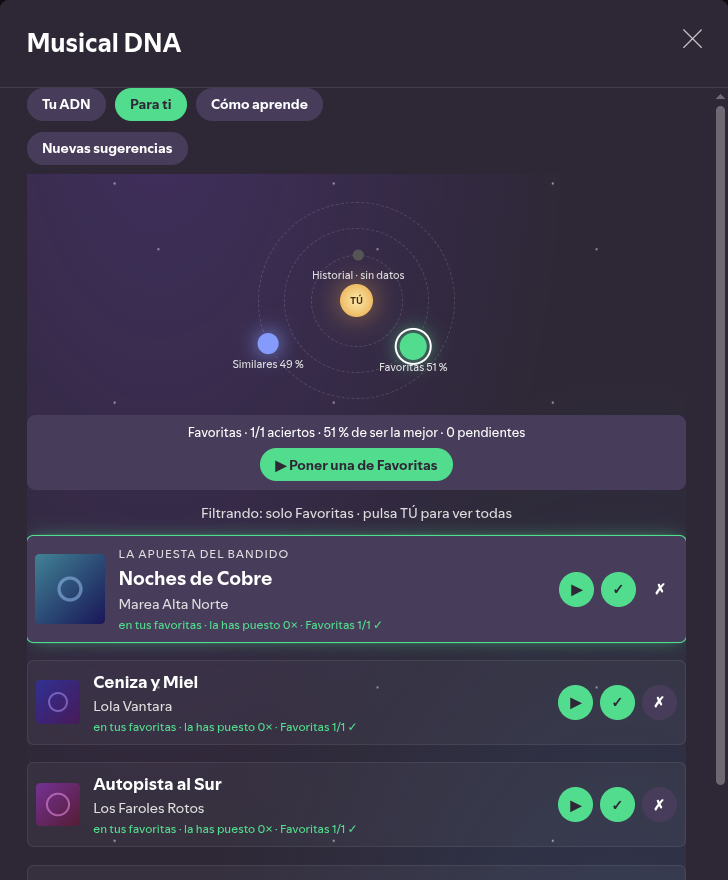
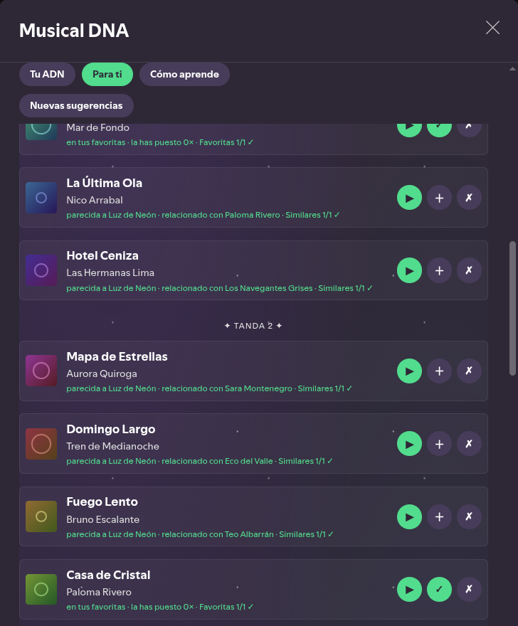

# Musical DNA

Extensión de [Spicetify](https://spicetify.app) que te enseña **qué define tu gusto** y te sugiere canciones con un pequeño recomendador que **aprende de lo que escuchas**. Todo se queda en tu equipo.

> **Estado: v0.1 en desarrollo.** Necesita [Listening Intelligence](https://github.com/D4vRAM369/listening-intelligence_spicetify): usa su historial. La interfaz está en español.

*English summary: a Spicetify extension that reads Listening Intelligence's local history (read-only) to show your "seed" songs with explainable scores, and suggests tracks from three sources (your history, your liked songs, songs similar to them) using a Thompson-sampling multi-armed bandit that learns which source works best for you. UI in Spanish.*

## Qué hace

Un icono (una doble hélice) en la barra superior abre un panel con tres pestañas:

| Pestaña | Qué ves |
|---|---|
| **Para ti** | Tu **sistema solar** y debajo las sugerencias. Arriba, «la apuesta del bandido». Cada una dice **por qué** está ahí y cuánto acierta su fuente. ▶ la reproduce, ＋ la guarda en «Canciones que te gustan» (pasa a ✓), ✗ la descarta para siempre (↺ deshace). Al bajar se cargan solas más tandas. |
| **Cómo aprende** | Aciertos de cada fuente, con qué probabilidad cree el bandido que cada una es la mejor y tus últimas pruebas (✓ / ✗ / ⏳). |
| **Tu ADN** | Tus canciones semilla en tres horizontes (7 días, 30 días, todo), con sus señales y un aviso cuando hay pocos datos. Y tu «antigusto»: lo que siempre saltas. |

<p align="center">
  
</p>

### Tu sistema solar

Tú eres el sol y cada fuente es un planeta que orbita a tu alrededor. **Cuanto más grande y brillante, más probable es que sea tu mejor fuente** según lo aprendido. Una fuente sin candidatos sale en gris.

**Pulsa un planeta** para ver solo las sugerencias de esa fuente, su ficha (aciertos, probabilidad, pruebas pendientes) y un botón para poner una de sus canciones. Pulsa el sol (TÚ) o el mismo planeta para volver a verlas todas.

<p align="center">
  
  &nbsp;
  
</p>

Al llegar al final de la lista se añade otra tanda («✦ Tanda 2 ✦»…), sin repetir nada de lo que ya has visto, hasta que no quedan más candidatos. Si tienes activado «reducir movimiento» en el sistema, nada se anima.

### Cómo aprende

Inspirado en el sistema de recomendaciones de Spotify (*bandidos multibrazo*; McInerney et al., 2018, «Explore, Exploit, and Explain»), en pequeño:

1. Hay tres fuentes: **tu historial** (lo que te gusta y hace días que no suena), **tus favoritas** (las guardadas que menos pones) y **similares** (canciones top de artistas relacionados con tus semillas).
2. Cuando pulsas ▶, se anota la prueba: si Listening Intelligence registra esa canción en las 6 h siguientes y la escuchas ≥30 s, la fuente suma un acierto; si la saltas, un fallo. Pulsar ▶ otra vez en la misma sugerencia no cuenta doble.
3. ＋ (guardar) es un acierto al momento y ✗ (descartar) un fallo al momento: son las señales más claras que le das.
4. Arriba va «la apuesta»: la fuente que más acierta. El resto se reparte con *Thompson sampling*: cada fuente es una «campana» de lo que podría valer; se saca un número de cada una y gana el mayor. Así, **cuanto menos sabe de una fuente, más la prueba; cuanto más sabe, más apuesta por la que acierta**, sin ningún porcentaje fijo de exploración.
5. Para que haya variedad, como mucho 2 canciones del mismo artista por tanda.

Nunca te sugiere lo que sonó en las últimas 72 h, lo que siempre saltas ni lo que descartaste.

## Privacidad

- **Nada sale de tu equipo.** Sin servidor ni cuentas.
- Lee la base de datos de Listening Intelligence **en solo lectura**: nunca la modifica.
- Para favoritas y similares usa APIs internas del propio cliente de Spotify. Si fallan, esas fuentes se desactivan y el resto sigue.
- Sus propios datos (las pruebas) están en `musical-dna:v1`. **Exportar** y **Borrar** en el pie del panel.
- ＋ y ✗ solo tocan tu biblioteca cuando tú lo pides: ＋ guarda, ✓ quita; ✗ nunca borra nada de tu biblioteca.

## Instalación

**Requisitos:** Spotify de escritorio con Spicetify y Listening Intelligence instalada.

```bash
cp musical-dna.js "$(spicetify path userdata)/Extensions/"
spicetify config extensions musical-dna.js     # se AÑADE a las que ya tengas
spicetify apply
```

Para desinstalar: `spicetify config extensions musical-dna.js-` y `spicetify apply`.

## Desarrollo

Un solo archivo, por capas: lógica pura arriba (exportada como `core`, sin Spotify), lectura de datos y adaptadores en medio, interfaz abajo.

```bash
node --test tests/     # Node 20+, sin dependencias
# Para desarrollar sin copiar tras cada cambio: enlace simbólico (una vez) y luego solo `spicetify apply`
ln -sfn "$PWD/musical-dna.js" "$(spicetify path userdata)/Extensions/musical-dna.js"
```

## Licencia

[MIT](LICENSE).
